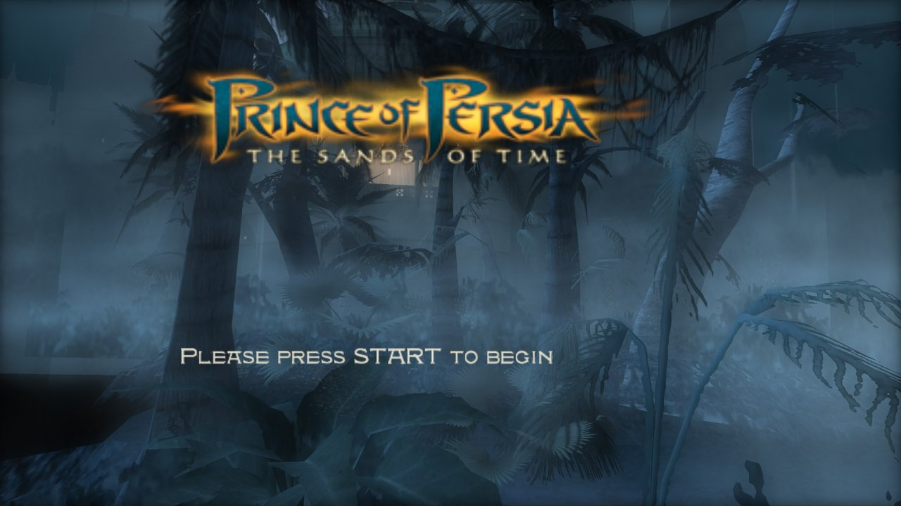
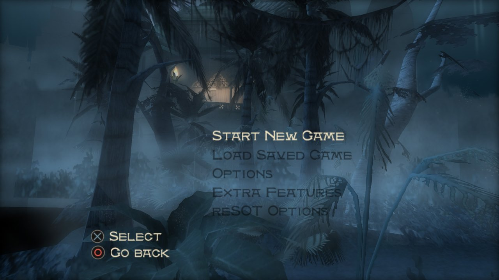
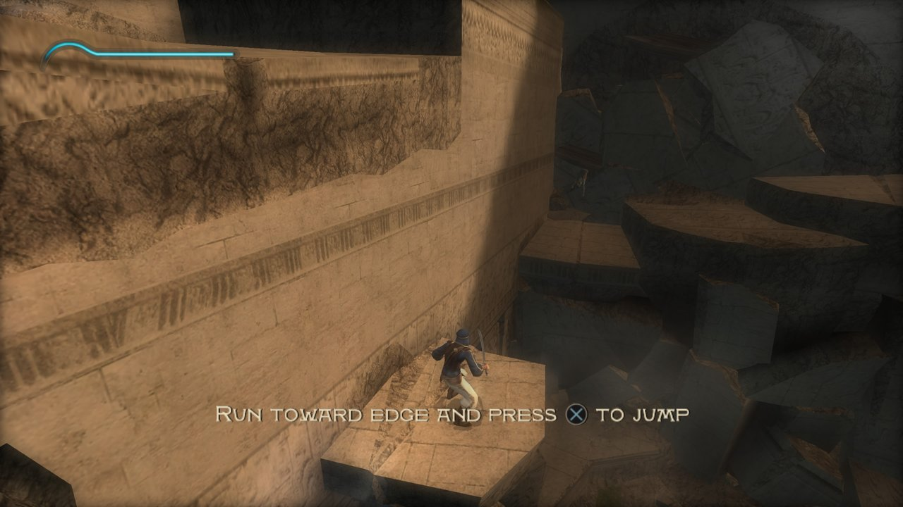
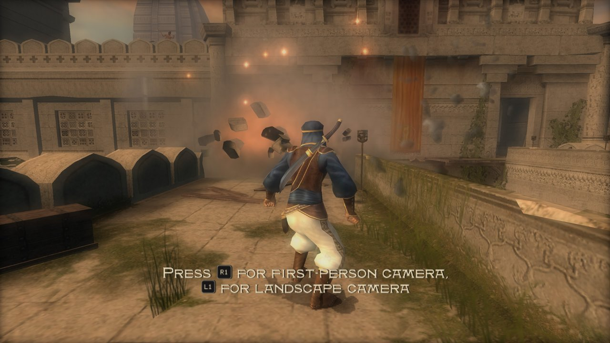
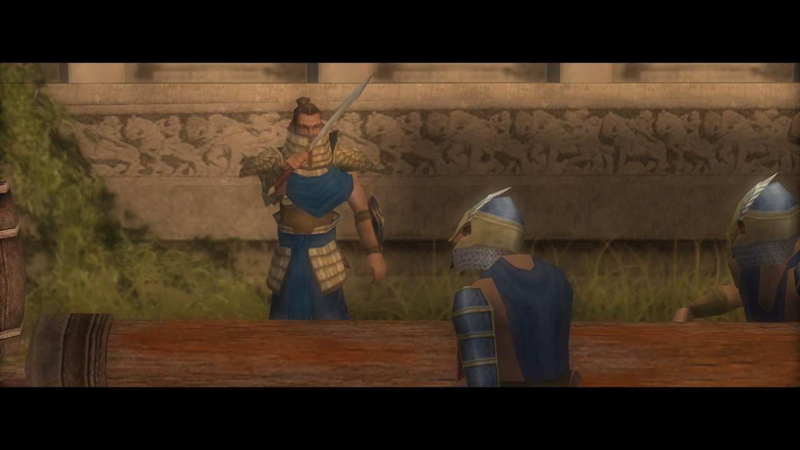
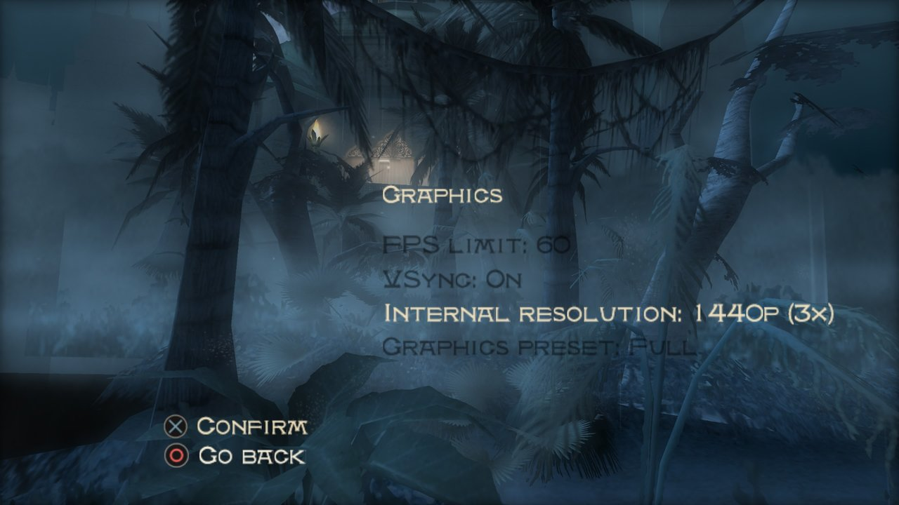

  

  <b>Prince of Persia: The Sands of Time, the original Xbox version, statically recompiled 
  into a native app for homebrew-enabled PS5 consoles.</b>

  
  

  <a href="#install"><b>Install</b></a>
  &nbsp;·&nbsp;
  <a href="#controls">Controls</a>
  &nbsp;·&nbsp;
  <a href="#settings">Settings</a>
  &nbsp;·&nbsp;
  <a href="#reporting-a-bug">Report a bug</a>

> [!IMPORTANT]
> **Bring your own game.**
> This project does not include or distribute copyrighted game files. Use a dump of your own original disc.
> Please do not request or share game downloads here.

> [!CAUTION]
> **We do not support piracy.**
> Please do not use this project with pirated copies of the game.

  
  
  
  
  
  

Screenshots taken on a PS5 with the US disc's files
at 1440p (3x) internal resolution.

## What it is

A PS5 fork of [FulGerNet/rePOP](https://github.com/FulGerNet/rePOP), the reSOT static
recompilation. The PS5 host provides Vulkan rendering through RADV, DualSense input and
AudioOut sound. Windows and Android builds are maintained upstream.

## Highlights

- **4K output**, with adjustable internal resolution, graphics preset, frame limit and VSync.
- **DualSense prompts** in the game's menus and gameplay.
- **In-game options**, including Special Load Map and a cheats switch.
- **Separate user data**, so app updates keep your saves and settings.

## Requirements

- A homebrew-enabled PS5 with ShadowMountPlus and an FTP server.
- A dump of your own **USA Xbox retail disc** of *The Sands of Time*.
  The executable must match `RESOT_XBE_SHA256` in `source/xbox-retail/target.h`.

## Install

You can also install the app from [RecompStore](https://recompstore.com/game/PPSA99023) or [ProsperoStore](https://prosperostore.net/app/PPSA99023/).
You still need to provide your own disc files as described below.

1. Download `PPSA99023-<version>.zip` from
   [Releases](https://github.com/bystritskiy/rePOP-ps5/releases), extract it
   and copy the `PPSA99023` folder to `/data/homebrew/` on the console.
   ShadowMountPlus registers it as **reSOT - The Sands of Time**.
2. Extract your Xbox retail disc (for example with
   [extract-xiso](https://github.com/XboxDev/extract-xiso)) and copy all its
   files and folders to `/data/reSOT/xbox-retail/`, or to
   `reSOT/xbox-retail/` on a USB drive.
3. Start the app. `default.xbe` must be the supported retail version (its
   SHA-256 is `RESOT_XBE_SHA256` in `source/xbox-retail/target.h`); another
   revision is refused, because the recompiled addresses are only valid for
   that file. If no usable files are found, the app says where to copy them.

**To update,** replace the `PPSA99023` app folder. Your user data is kept separately.

## Controls

DualSense: Cross/Circle/Square/Triangle = A/B/X/Y, L1/R1 = White/Black,
L2/R2 = the triggers, Options = Start, touchpad click = Back. Controls can be
changed in the game's reSOT Options menu.

## Settings

Open **reSOT Options → Graphics** to change internal resolution, graphics preset, frame
limit and VSync. A fresh install defaults to 2160p (4.5x), the Full preset and VSync on.

## Your files

Saves, options, shader caches and logs are stored in `/data/reSOT/PPSA99023/`.
Disc files are kept separately in `/data/reSOT/xbox-retail/`.

## Known issues

Version **01.005.000** is based on upstream reSOT v0.5.0. Only the **USA Xbox disc** is
accepted by the PS5 build, even though upstream also supports the European release.

On 2026-11-03, this build was checked through the menus, the five-language page and about
three minutes of the first level at 59.7–60.0 fps. Earlier builds were also checked at
1440p and 2160p internal resolution. These checks do not establish full-game stability.

Sound, input through a whole level, rumble, saves, later levels, USB/extended-storage game
files, other firmware and loaders, and the Xbox demo remain unverified. Full-screen movie
cropping and scaling also await console verification.

Test setup: FW 13.40, kstuff-lite 1.11 and ShadowMountPlus 1.7-beta5fix1.
See [validation records](docs/VALIDATION.md) and [release notes](docs/releases/).

## Reporting a bug

Open an [issue](../../issues) with the app version, firmware, steps to reproduce, expected
result and actual result. Include relevant logs from `/data/reSOT/PPSA99023/`.
Do not attach game files or disc images. Report PS5-specific problems here rather than upstream.

## For developers

The macOS build uses the public PS5 PayloadSDK, Clang 18, SDL3 and RADV.
See [build and packaging instructions](port/ps5/README.md) and the
[recompilation overview](docs/RECOMP.md) for the platform layer and runtime details.

## Credits

- **reSOT** is the work of **FulGerNet**: the recompilation, the Xbox runtime
  and the Windows and Android ports. If you enjoy the game on PS5, you can
  support FulGerNet at [buymeacoffee.com/fulger](https://www.buymeacoffee.com/fulger).
- The PS5 port builds on [PS5_Vulkan](https://github.com/mihawk-99/PS5_Vulkan),
  [PS5_Mesa](https://github.com/mihawk-99/PS5_Mesa) (RADV),
  [PS5_PayloadSDK](https://github.com/mihawk-99/PS5_PayloadSDK), SDL3 and
  xboxrecomp; exact revisions are in
  `port/ps5/dependencies.json` and notices in `port/ps5/NOTICE.md`.
- PS5 port: [bystritskiy](https://github.com/bystritskiy).

Problems with the PS5 build belong here, not upstream: upstream does not
maintain or support it.

## License

reSOT's own files are MIT ([LICENSE](LICENSE)). The vendored runtime includes
MIT and LGPL-2.1-or-later components, and the PS5 executable follows
PS5_Vulkan's GPL-3.0-or-later link and runtime recipe with statically linked
RADV/Mesa, so the combined PS5 build is also under those terms. The game, its
assets and the generated game and XDK code belong to their owners and are not
covered by reSOT's licence. See [docs/LICENSING.md](docs/LICENSING.md).

*Prince of Persia* is a trademark of Ubisoft. This project is not affiliated
with or endorsed by Ubisoft or Microsoft. PlayStation, PS5 and DualSense are
trademarks of Sony Interactive Entertainment; the PS5 port is not affiliated
with or endorsed by Sony.
