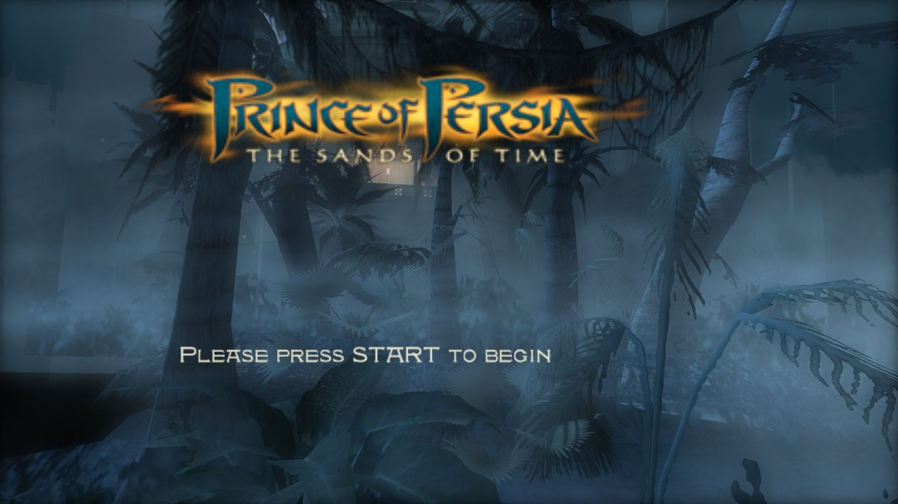
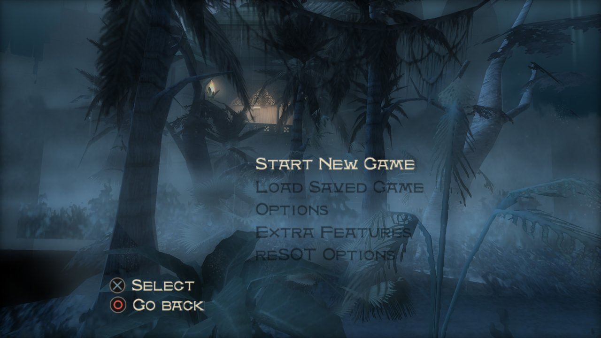
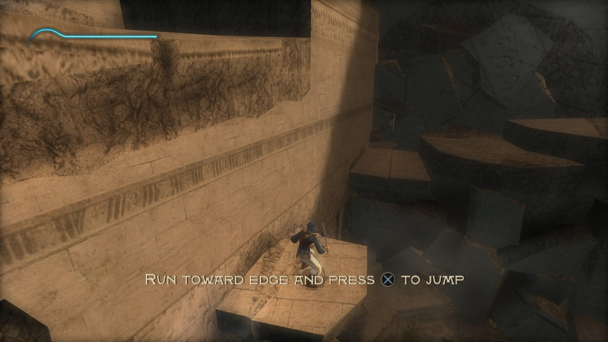
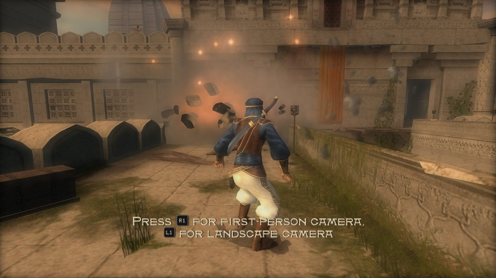
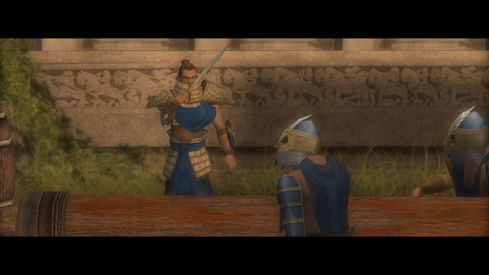
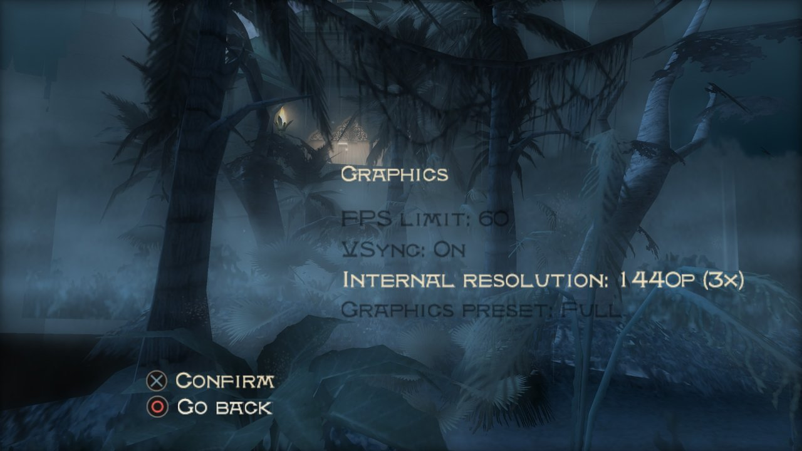

<p align="center">
  
</p>

# rePOP-ps5

**Prince of Persia: The Sands of Time on PS5, as a native app.**

rePOP-ps5 is a fork of [FulGerNet/rePOP](https://github.com/FulGerNet/rePOP)
that adds a PS5 host to reSOT, the static recompilation of the Xbox retail
game. The original game's code runs as native code on the console against
reSOT's replacement for the Xbox hardware, with Vulkan rendering (RADV),
DualSense input and PS5 audio. Windows and Android builds come from
[upstream](https://github.com/FulGerNet/rePOP); this fork is only about the
PS5.

**You need your own game.** The app contains no game data and no Xbox
executable. It runs the files of your own Xbox retail disc.

<p align="center">
  <a href="https://recompstore.com/game/PPSA99023"><picture>
    <source media="(prefers-color-scheme: dark)" srcset="https://recompstore.com/assets/press/badge-light.svg">
    
  </picture></a>
</p>

<p align="center">
  
  
  
  
  
  
</p>

<p align="center"><sub>Screenshots taken on a PS5 with the US disc's files
at 1440p (3x) internal resolution.</sub></p>

## Status

Version **01.004.000**, based on upstream reSOT v0.4.0. Tested on one
console: FW 13.40, kstuff-lite 1.11, ShadowMountPlus 1.7-beta5fix1.

Upstream v0.4.0 brings Special Load Map and a built-in cheats switch in reSOT
Options (main and pause menus), an HD menu font, and fixes for the crash in
7601 Salle and for the Prince with only a head after a map change; see its
[release notes](docs/releases/v0.4.0.md). With 01.004.000 on the console:
Special Load Map loads a chosen map, the cheats
switch works in play, 7601 Salle no longer crashes, the Prince keeps his body
after a map change, and a fresh install starts at 2160p with the Full preset.

Seen on the console (01.003.006 and 01.004.000):

- title screen, menus, the profile keyboard, the opening cutscene and early
  gameplay, with correct lighting, fog and textures;
- 3840x2160 output, and about 60 fps in play at 1440p (3x) and at 2160p
  (4.5x) internal resolution with the Full graphics preset;
- the app finding the disc files in `/data/reSOT/xbox-retail`;
- PlayStation buttons in the game's prompts (Cross, Circle, L1 and R1 seen
  so far).

A new install starts at 2160p (4.5x, the 4K output's size) with the Full
preset and VSync on; until 01.004.000 it started at 1440p with the Standard
preset (the README said Full). The internal resolution, the graphics preset,
the frame limit and VSync can be changed in the game's reSOT Options, Graphics. The story cutscenes
(640x346 movies) fill the 16:9 screen, cropping about 2% at each side, and
movies are scaled up with a bicubic filter; the full-screen cutscenes have
not been seen on the console yet.

Not checked yet: sound, controller input through a whole level, rumble,
saves, later levels, the screen shown when no game is found, game files on
USB or extended storage, other firmware and loaders, and the Xbox demo.
What was run and seen is recorded in [docs/VALIDATION.md](docs/VALIDATION.md).

## Install

1. Download `PPSA99023-<version>.zip` from
   [Releases](https://github.com/bystritskiy/rePOP-ps5/releases), extract it
   and copy the `PPSA99023` folder to `/data/homebrew/` on the console.
   ShadowMountPlus registers it as **reSOT - The Sands of Time**.
2. Extract your Xbox retail disc (for example with
   [extract-xiso](https://github.com/XboxDev/extract-xiso)) and copy all its
   files and folders to `/data/reSOT/xbox-retail/`, or to
   `reSOT/xbox-retail/` on a USB drive.
3. Start the app. `default.xbe` must be the supported retail version (its
   SHA-256 is `RESOT_XBE_SHA256` in `source/xbox-retail/target.h`); another
   revision is refused, because the recompiled addresses are only valid for
   that file. If no usable files are found, the app says where to copy them.

Options, shader caches, saves and logs are kept in `/data/reSOT/PPSA99023/`,
so replacing the app keeps them.

## Controls

DualSense: Cross/Circle/Square/Triangle = A/B/X/Y, L1/R1 = White/Black,
L2/R2 = the triggers, Options = Start, touchpad click = Back. Controls can be
changed in the game's reSOT Options menu.

## Building

The app is built on macOS with the public PS5 PayloadSDK, Clang 18, SDL3 and
RADV; no Sony SDK is used. Setup, build, packaging and the folder install
over FTP are in [port/ps5/README.md](port/ps5/README.md). The recompiled
game code in `source/xbox-retail/gen/` is upstream's and is not changed here.

## How it works

```text
Your default.xbe -> analyse and lift x86 to C -> native compiler
                                                   |
                 original game + linked Xbox libraries
                                                   |
                    reSOT platform and Xbox runtime
                                                   |
             PS5 host: SDL3 GPU over Vulkan/RADV, DualSense, AudioOut
```

The original BigFile loader, Jade engine, compiled AI, Bink decoder and Xbox
Direct3D code remain in the lifted program. reSOT replaces kernel services,
memory, threads, input, audio and video, and translates the NV2A pushbuffer
to host GPU rendering. The PS5 host adds direct-memory Xbox RAM, MMIO
decoding in the signal handler and a VideoOut path for SDL3; details in
[port/ps5/README.md](port/ps5/README.md) and [docs/RECOMP.md](docs/RECOMP.md).

## Credits

- **reSOT** is the work of **FulGerNet**: the recompilation, the Xbox runtime
  and the Windows and Android ports. If you enjoy the game on PS5, you can
  support FulGerNet at [buymeacoffee.com/fulger](https://www.buymeacoffee.com/fulger).
- The PS5 port builds on [PS5_Vulkan](https://github.com/mihawk-99/PS5_Vulkan),
  [PS5_Mesa](https://github.com/mihawk-99/PS5_Mesa) (RADV),
  [PS5_PayloadSDK](https://github.com/mihawk-99/PS5_PayloadSDK), SDL3 and
  xboxrecomp; exact revisions are in
  `port/ps5/dependencies.json` and notices in `port/ps5/NOTICE.md`.
- PS5 port: [bystritskiy](https://github.com/bystritskiy).

Problems with the PS5 build belong here, not upstream: upstream does not
maintain or support it.

## Licence

reSOT's own files are MIT ([LICENSE](LICENSE)). The vendored runtime includes
MIT and LGPL-2.1-or-later components, and the PS5 executable follows
PS5_Vulkan's GPL-3.0-or-later link and runtime recipe with statically linked
RADV/Mesa, so the combined PS5 build is also under those terms. The game, its
assets and the generated game and XDK code belong to their owners and are not
covered by reSOT's licence. See [docs/LICENSING.md](docs/LICENSING.md).

*Prince of Persia* is a trademark of Ubisoft. This project is not affiliated
with or endorsed by Ubisoft or Microsoft. PlayStation, PS5 and DualSense are
trademarks of Sony Interactive Entertainment; the PS5 port is not affiliated
with or endorsed by Sony.
